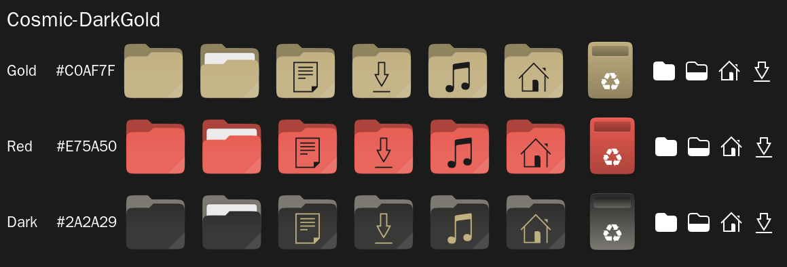
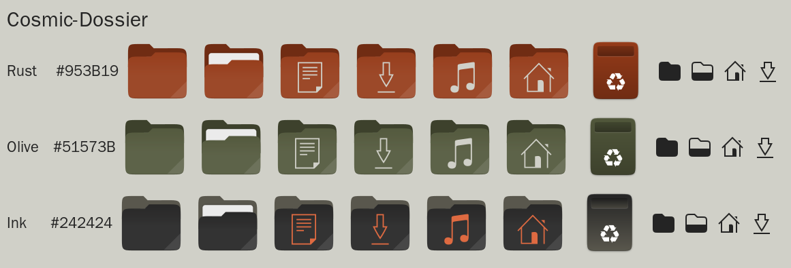
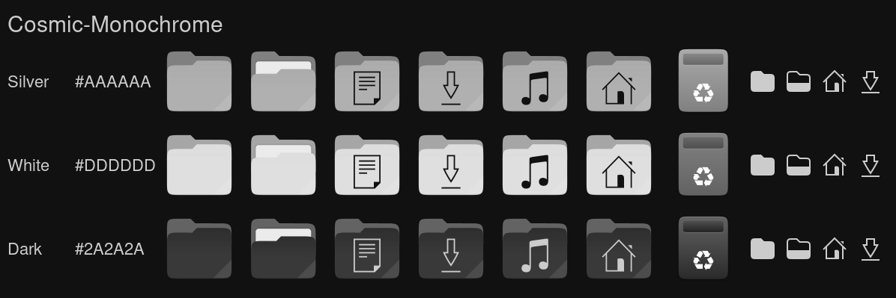
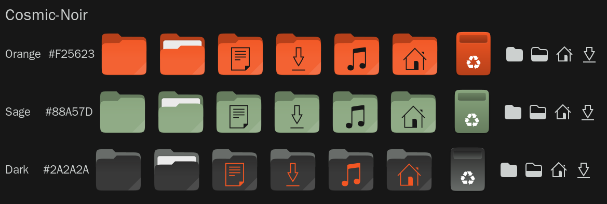
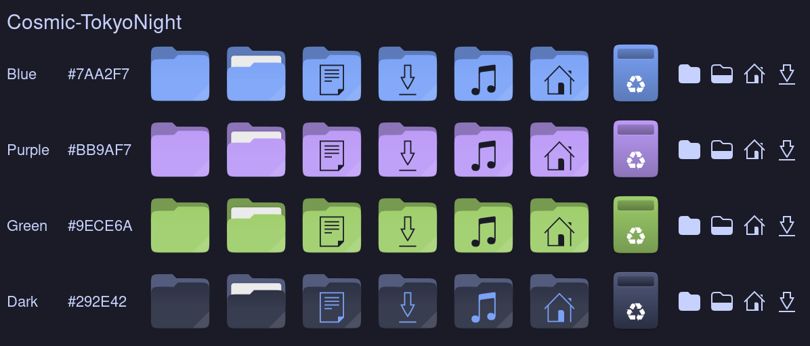
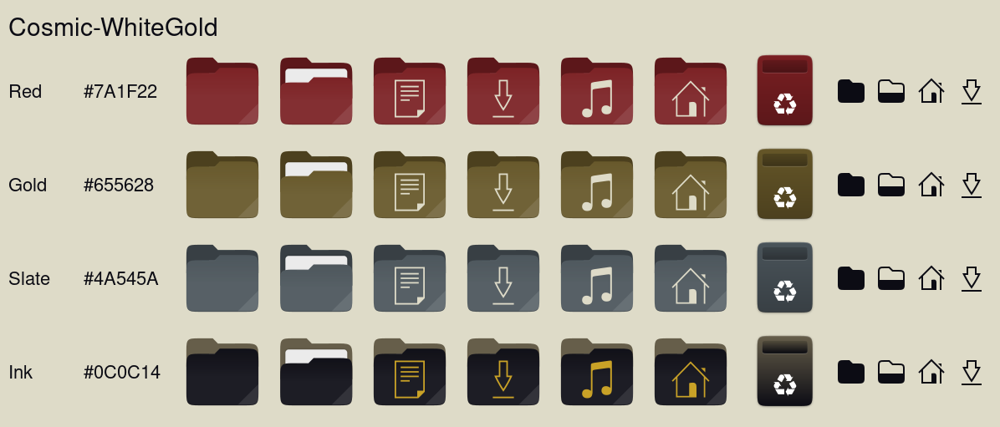

# Cosmic Icon Themes

Recolored builds of the Kanagawa icon pack by Fausto Korpsvart, matched to the cosmic-*-theme rices. Each theme comes in several folder colors taken from its own palette:

| Theme | Variants (first is the default) | Rice |
|---|---|---|
| DarkGold | Gold, Red, Dark | [cosmic-darkgold-theme](https://github.com/atraxsrc/cosmic-darkgold-theme) |
| Dossier | Rust, Olive, Ink | [cosmic-dossier-theme](https://github.com/atraxsrc/cosmic-dossier-theme) |
| Monochrome | Silver, White, Dark | [cosmic-monochrome-theme](https://github.com/atraxsrc/cosmic-monochrome-theme) |
| Noir | Orange, Sage, Dark | [cosmic-noir-theme](https://github.com/atraxsrc/cosmic-noir-theme) |
| TokyoNight | Blue, Purple, Green, Dark | [cosmic-tokyonight-theme](https://github.com/atraxsrc/cosmic-tokyonight-theme) |
| WhiteGold | Gold, Red, Slate, Ink | [cosmic-whitegold-theme](https://github.com/atraxsrc/cosmic-whitegold-theme) |

Symbolic and small icons take the theme's text color, so light themes stay readable.

## Previews








## Install

**With a rice:** each theme repo above has `./icons/install.sh`, which downloads its pack from the latest release, checks the SHA256 and sets it as the COSMIC icon theme:

```bash
./icons/install.sh                    # default folder color
./icons/install.sh --variant Red      # see --list
./icons/install.sh --system           # /usr/share/icons, all users + login screen (sudo)
```

**By hand:** download a pack from [Releases](https://github.com/atraxsrc/cosmic-icon-themes/releases/latest), then:

```bash
sha256sum -c --ignore-missing SHA256SUMS
tar -C ~/.local/share/icons -xJf Cosmic-Noir-Orange.tar.xz
```

Then pick the icon theme in COSMIC Settings > Desktop > Appearance > Icons. Restart open apps (COSMIC Files caches icons per window).

## Build

```bash
./scripts/fetch-upstream.sh
python3 -m cosmic_icons.build                                   # all 20 packs into dist/
python3 -m cosmic_icons.build --theme Noir                      # all Noir variants
python3 -m cosmic_icons.build --theme TokyoNight --variant Purple
python3 -m cosmic_icons.preview                                 # refresh previews/
./scripts/package.sh                                            # dist/release/*.tar.xz + SHA256SUMS
```

Each pack is about 89 MB unpacked (about 6 MB as `.tar.xz`), so build only what you use. A local build installs with `cp -a dist/Cosmic-Noir-Orange ~/.local/share/icons/`.

## Tests

```bash
python3 -m unittest discover -s tests -t . -v
```

## Credits and license

Based on the Kanagawa icon pack from https://github.com/Fausto-Korpsvart/Kanagawa-GKT-Theme (pinned commit in `scripts/fetch-upstream.sh`), which builds on Suru++ and Papirus. Full credits are kept in each pack's `index.theme`. Licensed GPL-3.0, see `LICENSE`.
